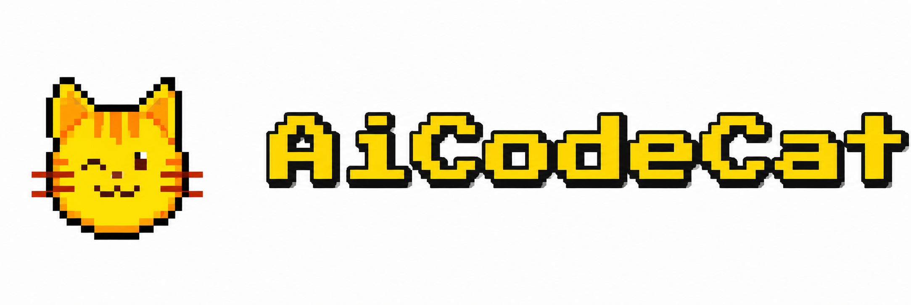

# URL-image（curl 生图技能）

<p align="center">
  
</p>

> 生图技能 `image-curl`：用 `curl` 调用 [aicode.cat](https://aicode.cat) 的生图接口，支持 **GPT 生图**（`gpt-image-2.6` 等）与 **Gemini 生图**（`gemini-nano-banana-2.1` 等），完成文生图、图生图、批量生图与线程内改图。

`URL-image` 仓库打包了面向 aicode.cat 的生图技能，Codex 与 Claude Code 都能用。它读取 skill 目录 `local.env` 中的生图专用 Key，把结果保存为本地图片文件。

- **默认接入 `https://aicode.cat`**
- GPT 生图：`POST /v1/images/generations`、`POST /v1/images/edits`，默认模型 `gpt-image-2.6`
- Gemini 生图：`POST /v1beta/models/{model}:generateContent`，默认模型 `gemini-nano-banana-2.1`
- 按模型名自动选接口；两类 Key 分开放：`IMAGE_CURL_API_KEY`（GPT 分组）、`IMAGE_CURL_GEMINI_API_KEY`（Gemini 分组）
- 不依赖 `cpa`、`cliproxy-image-cli` 或其他生图 CLI
- **用户一旦提出生图或改图需求，Agent 必须调用本技能，不得跳过脚本直接作答**

## GPT 与 Gemini 怎么选

| 需求 | 选 |
|---|---|
| 默认、透明背景、PNG / WebP 输出、蒙版局部改图、`--input-fidelity` | GPT（`gpt-image-2.6` 等） |
| 用户点名 Gemini / Nano Banana、超宽超高比例（`4:1`、`1:8` 等）、多张参考图合成（最多 14 张） | Gemini（`gemini-nano-banana-2.1`、`gemini-3.1-flash-image`） |

当前 Key 能用哪些模型，跑 `image-curl.sh models` 查。各型号单价看 aicode.cat 控制台。

## 功能

- 统一入口 `image-curl.sh` / `image-curl.ps1`：`generate`、`edit`、`generate-batch`、`models`
- 文生图、图生图（GPT 用 multipart `images/edits`，Gemini 用内联参考图）
- 尺寸简写：GPT 用白名单（`16:9`、`9:16@2k`、`4k@16:9` 等）；Gemini 用宽高比 + 档位（`16:9@2k`、`4:1`、`4k` 等）
- 输出：`--output`、`--output-dir`、`--name`；默认 `~/.codex/generated_images/<thread|manual>/`
- 线程占位符：`[Image #N]`、`[Turn -1 Image #1]`、`[Thread Image #N]`、`[Last Output]`；`--image-set`
- 批量 JSONL，同一批可混用 GPT 与 Gemini
- dry-run、metadata、覆盖保护、多张输出；无图返回、5xx、网络抖动自动重试
- 接口报错会带上原文和处理提示（例如 Key 分组不对）

不做网页搜图或 SVG 编辑。

## 系统要求

| 平台 | 统一入口 | 依赖 |
|---|---|---|
| macOS / Linux | `image-curl.sh` | `bash`、`curl`、Python 3.8+ |
| Windows | `image-curl.ps1` | PowerShell 5.1+、`curl.exe`、Python 3.8+（`py -3`、`python3` 或 `python`） |

所有逻辑在 `skill_src/image-curl/scripts/lib/image_curl.py`；`.sh` / `.ps1` 只找到 Python 并转交参数，所以两个平台行为一致。macOS 自带的 Bash 3.2 即可。

```bash
curl --version && python3 --version
```

```powershell
$PSVersionTable.PSVersion; curl.exe --version; py -3 --version
```

## 安装

```bash
git clone https://github.com/KonglingDaDa/URL-image.git
cd URL-image

# Codex
mkdir -p ~/.codex/skills
cp -R ./skill_src/image-curl ~/.codex/skills/image-curl
chmod +x ~/.codex/skills/image-curl/scripts/*.sh
cp ~/.codex/skills/image-curl/local.env.example ~/.codex/skills/image-curl/local.env
chmod 600 ~/.codex/skills/image-curl/local.env

# Claude Code：把上面的 ~/.codex/skills 换成 ~/.claude/skills
```

Windows（PowerShell，在仓库目录执行）：

```powershell
$skill = Join-Path $env:USERPROFILE '.codex\skills\image-curl'
Copy-Item -Recurse .\skill_src\image-curl $skill
Copy-Item (Join-Path $skill 'local.env.example') (Join-Path $skill 'local.env')
```

自定义 `CODEX_HOME` 时，把 `~/.codex/skills` 换成 `$CODEX_HOME/skills`。

## 配置生图专用 Key（重要）

在 aicode.cat 控制台「API 密钥」页，为生图分组各建一个 Key，**只写进本 skill 的 `local.env`**：

```bash
# ~/.codex/skills/image-curl/local.env
IMAGE_CURL_API_KEY=GPT生图分组的Key
IMAGE_CURL_GEMINI_API_KEY=Gemini生图分组的Key
# 只有 Gemini Key 时，让默认模型走 Gemini：
# IMAGE_CURL_MODEL=gemini-nano-banana-2.1
```

GPT 分组的 Key 不能调 Gemini 模型，反过来也一样；用错了脚本会直接提示该改哪个变量。

**禁止写入** `~/.codex/auth.json`、`~/.codex/config.toml`、`~/.claude/settings.json` 或任何全局配置。

验证配置（`--dry-run` 不需要 Key，也不会扣费）：

```bash
~/.codex/skills/image-curl/scripts/image-curl.sh generate --prompt "测试" --name test --dry-run
~/.codex/skills/image-curl/scripts/image-curl.sh generate --model gemini-nano-banana-2.1 --prompt "测试" --name test --dry-run
~/.codex/skills/image-curl/scripts/image-curl.sh models
```

```powershell
& "$env:USERPROFILE\.codex\skills\image-curl\scripts\image-curl.ps1" generate --prompt "测试" --name test --dry-run
```

确认 `endpoint` 指向 `https://aicode.cat`、`authorization` 已打码后，再真实生图。

## 在 Codex / Claude Code 中使用

```text
$image-curl 可爱猫女
$image-curl 生成横版赛博城市壁纸，尺寸 16:9，保存名 cyber-city
用 Gemini 画一张竖版海报：雨夜霓虹街道，2K
$image-curl image="./photo.png" prompt="把背景换成星空" name="starry"
$image-curl image="[Last Output]" prompt="继续细化上次结果" name="refined"
```

批量：

```text
$image-curl generate-batch input="./prompts.jsonl" output_dir="./batch-out"
```

完整参数与占位符规则见 `skill_src/image-curl/SKILL.md` 与 `skill_src/image-curl/references/cli.md`。

## 直接运行脚本

```bash
S=~/.codex/skills/image-curl/scripts

# GPT 文生图
$S/image-curl.sh generate --prompt "日系插画猫女头像" --output ./catgirl.png --size 1024x1024

# Gemini 文生图（2K 横版）
$S/image-curl.sh generate --model gemini-nano-banana-2.1 --prompt "清晨的咖啡馆" --size 16:9@2k --name cafe

# GPT 改图（蒙版）
$S/image-curl.sh edit --image ./photo.png --mask ./mask.png --prompt "把背景换成星空" --input-fidelity high --name starry

# Gemini 多图合成
$S/image-curl.sh edit --model gemini-nano-banana-2.1 --image ./cat.png --image ./cafe.jpg --prompt "把猫放进咖啡馆" --name cat-cafe

# 批量
$S/image-curl.sh generate-batch --input ./prompts.jsonl --output-dir ./batch-out
```

## 配置读取规则

- **base URL**：`--base-url` → `IMAGE_CURL_BASE_URL` → 默认 **`https://aicode.cat`**
- **GPT Key**：`--api-key` → `IMAGE_CURL_API_KEY` → `OPENAI_API_KEY` → `CLIPROXY_API_KEY` → `auth.json`（兜底，勿放生图 Key）
- **Gemini Key**：`--api-key` → `IMAGE_CURL_GEMINI_API_KEY` → `IMAGE_CURL_API_KEY`
- `local.env` 的值优先于同名环境变量

## 项目结构

```text
skill_src/
  image-curl/
    SKILL.md
    local.env.example
    references/cli.md
    agents/openai.yaml
    scripts/
      image-curl.sh / image-curl.ps1          统一入口（薄壳）
      generate_image.* / edit_image.* / generate_batch.*
      common.sh / ImageCurl.Common.ps1        只负责找 Python
      lib/
        image_curl.py                         全部逻辑：参数、尺寸、请求、保存、批量
        allowed_sizes.json                    尺寸唯一真源（GPT 白名单 + Gemini 表）
        normalize_size.py
        thread_state.py
        parse_batch_jsonl.py
    tests/
README.md
AGENTS.md
```
